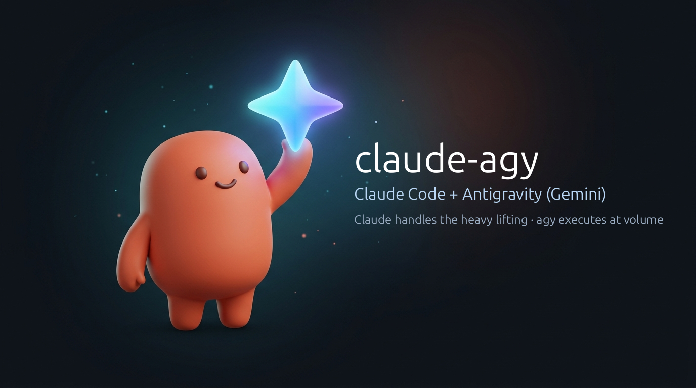

<p align="center">
  
</p>

# claude-agy

<p align="center">
  <a href="README.md">Leia em português</a> · <b>English</b>
</p>

<p align="center">
  <a href="https://github.com/Davicjc/claude-agy/actions/workflows/testes.yml"></a>
</p>

A **Claude Code** plugin that pairs Claude with **agy** (Antigravity CLI, powered by Gemini models) as an engineering team:
Claude acts as the **Tech Lead & Architect** (handling the "heavy lifting", critical reasoning, safety boundaries, and final decisions), while agy acts as the **High-Volume Execution Engine** (repetitive grunt work, multimodal tasks, and independent reviews) — **saving valuable tokens and keeping Claude's context window pristine**.

---

## Why this pairing? (Role division)

In real-world projects, burning Claude's context window and expensive token quota on repetitive grunt work or massive file dumps is costly and inefficient. This plugin pairs the strengths of both:

| Role | Agent | Responsibilities |
|---|---|---|
| **The Heavy Lifter**<br>*(Tech Lead & Architect)* | **Claude Code** | • Plans architecture and breaks complex problems into isolated chunks<br>• Defines strict safety boundaries and clear execution contracts<br>• **Never takes "done" on faith**: audits real git diffs, runs tests, inspects UI<br>• Makes critical architectural decisions and final approvals |
| **The Execution Engine**<br>*(Volume & Multimodal)* | **agy (Gemini)** | • Grunt work: repetitive refactors across dozens of files, boilerplate, and migrations<br>• Native multimodal: generating/editing banners, mockups, icons, transcribing WhatsApp audios, analyzing .mp4 videos<br>• Independent peer review: another model family, another perspective, zero confirmation bias |

---

## Real token & context savings

- **Preserve Claude's premium quota**: Deep documentation research, wide codebase scans, and bulk generation run on Gemini via agy. Claude's quota is reserved for what requires deep cognitive reasoning.
- **Uncluttered context**: Claude doesn't get flooded with hundreds of lines of build logs or intermediate code. Output is condensed to at most 150 lines alongside a clean git diff. Full output is saved to disk (`resposta.md`), read only when needed.
- **Sharp reasoning end-to-end**: Long sessions stay fast and alert because Claude's conversation history doesn't bloat with operational churn.

---

## What it does

| Feature | How |
|---|---|
| **Delegate tasks without wasting quota** | `agy-tarefa` runs heavy execution in agy in the background, with allowed folders, a time limit, and fixed safety rules in the prompt |
| **Don't trust "done"** | Compares git before and after (with a content hash of each file) and shows **what actually changed**. Flags it if agy makes a commit, times out or returns an empty answer |
| **Saves context and tokens** | Claude only gets the essentials of the answer (up to 150 lines) and the clean diff. Long text stays in a file, read only when needed |
| **Always the current model** | `agy-modelo` reads `agy models` at run time and picks the newest version for each role (code, review, image, research, fast). A new Gemini release is used without editing anything |
| **Independent cross review** | `agy-revisar` sends a `git diff` to agy for a **read-only** review and gets a verdict and findings in a fixed format: severity, confidence, file:line, evidence and suggestion |
| **Parallel work** | The skill teaches Claude to split work into parts that share no files (one `git worktree` per part), run them at the same time and validate each one before merging |
| **Images, audio, video** | Banners, mockups, icons, WhatsApp voice note transcription, .mp4 analysis, straight from the file |
| **Saving mode** | When Claude's quota runs high (week ≥ 70% or 5-hour window ≥ 80%), Claude only commands: it decides, writes a near-foolproof directive and agy does almost all the work. `agy-cota` says when to switch |
| **Accountability** | `agy-historico` lists runs with status, model, time and tokens spent in agy. Each run keeps its prompt, answer and changes in `~/.cache/agy-skill/execucoes/` |

Claude uses the skill on its own when the task calls for it. You can also call it directly:

| Command | What it does |
|---|---|
| `/agy:delegar <task>` | Delegates to agy and validates the result before calling it done |
| `/agy:revisar [--base main]` | Cross review of the current changes; Claude checks each finding and says which ones are real |
| `/agy:modelos` | Models available in agy and which one each role uses |
| `/agy:historico [N]` | Latest runs and tokens spent |
| `/agy:cota` | Claude quota usage and whether saving mode is on |

Or in plain words: *"have agy refactor these 30 files to the new pattern"*, *"have agy make the README banner with the brand colors"*, *"transcribe this WhatsApp audio in ~/Downloads"*, *"do a cross review of what changed since main"*.

---

## Actually tested

**With the real agy:**

| Test | Result |
|---|---|
| Fix a bug and add a test | Done in 27 s; the git report confirmed the changed and new files |
| Review with 3 planted problems (SQL injection, hard-coded password, division by zero), one in a new untracked file | **All 3 found**, each with a failure scenario and a fix |
| Continue the same conversation (`--continuar`) | agy remembered what was said in the previous call |
| Ask agy on purpose to make a commit | Detected (exit code 3), with the commit and its files listed |
| This plugin's icon | Made by agy itself (`--papel imagem`) and checked before use |
| **The skill reviewing itself** (4 rounds) | 11 real findings in its own scripts, each one checked first and all fixed. One suggestion was **rejected**: turning off `safe.directory` as root would open a security hole |

**Automated** ([`tests/rodar.sh`](tests/rodar.sh), with a fake agy, no network and no cost): 114 checks on every push. That is 98 as a regular user, on **Linux** and on **macOS with its stock bash 3.2**, plus 16 that only make sense **as root**, on Linux. They cover model selection (including models that don't exist yet), bad options, unwanted commits, timeouts, empty answers, edits to an already modified file, a 150 KB request, long output being trimmed, parallel runs, file ownership (with hardlink protection), git refusing a repo owned by someone else, reviewing from a subfolder, large diffs, repositories with no commits and reading Claude's quota (saving mode).

---

## Installation

### Requirements

- [Claude Code](https://claude.com/claude-code)
- **agy** (Antigravity CLI) installed and logged in: `agy models` must list the models
- `bash`, `git` and `python3`

| System | Status |
|---|---|
| Linux | Tested with the real agy and in the automated tests |
| macOS | Automated tests with the stock bash 3.2. Optional: `brew install coreutils` for the extra external time limit |
| Windows | Through WSL (it is Linux); Git Bash was not tested |

### In Claude Code

In one step (Claude Code 2.1.275 or newer):

```
/plugin install agy --marketplace Davicjc/claude-agy
```

Or in two steps (any version):

```
/plugin marketplace add Davicjc/claude-agy
/plugin install agy@davicjc
```

Then run `/reload-plugins` (or start a new session) and try `/agy:modelos`.

### Saving mode (optional, recommended)

Claude Code only hands quota usage (5-hour window and week) to the **status line**. For `agy-cota` to see those numbers, put this in `~/.claude/settings.json`:

```json
{
  "statusLine": {
    "type": "command",
    "command": "sh -c 'd=$(ls -d ~/.claude/plugins/cache/davicjc/agy/*/ | sort -V | tail -1); exec python3 \"$d/skills/agy/scripts/agy-cota\" --statusline'"
  }
}
```

The bar then shows something like `Opus · 5h 34% · semana 74% · modo agy`. Change the thresholds with `AGY_COTA_SEMANA` (default 70) and `AGY_COTA_SESSAO` (default 80). Quota usage is only reported to claude.ai Pro, Max and Ultra subscribers. If you already have a status line, call `agy-cota --statusline` from it with the same input JSON.

### Update

```
/plugin marketplace update davicjc
```

---

## The scripts (they also work on their own)

They live in `plugins/agy/skills/agy/scripts/`. Script names, options and messages are in Portuguese
(`--papel` = role, `--modo` = mode, `--nome` = label, `--prompt-arquivo` = prompt file, `--continuar` = continue).

```bash
# Which model to use (read from agy now)
agy-modelo --listar --atualizar
agy-modelo codigo                      # -> e.g. gemini-4-argon-high

# A task that edits files
agy-tarefa --dir ~/project --papel codigo --nome "login screen" \
           --prompt-arquivo request.md --timeout 2400

# Read/analyze only (no edits)
agy-tarefa --dir ~/project --modo plan --papel pesquisa --prompt "Explain how the cache works"

# Continue the same conversation (id in meta.json)
agy-tarefa --dir ~/project --continuar <id> --prompt "Now fix the button"

# Cross review
agy-revisar --dir ~/project                      # everything since HEAD, new files included
agy-revisar --dir ~/project --base main          # since main
agy-revisar --dir ~/project --intervalo HEAD~3..HEAD --foco "concurrency"
agy-revisar --dir ~/project --exigir-aprovado    # exit code 4 unless approved (automation)

# History and tokens
agy-historico 20

# Claude quota: time for saving mode?
agy-cota                               # MODO=economia|normal|desconhecido, SEMANA=, SESSAO=, MOTIVO=
```

**Roles:** `codigo` (code), `revisao` (review), `pesquisa` (research), `imagem` (image), `rapido` (fast). **Force a model:** `AGY_MODELO_CODIGO=<id>` (per role) or `AGY_MODELO=<id>` (all roles).

| Exit code | `agy-tarefa` | `agy-revisar` |
|---|---|---|
| `0` | ok | review done |
| `1` | agy error or empty answer | agy failed |
| `2` | bad usage | bad usage |
| `3` | ok, but agy made a commit | — |
| `4` | — | verdict not approved (with `--exigir-aprovado`) |
| `124` | timed out | — |

---

## Built-in safety rules

- agy can only see and edit the folders passed with `--dir` (without `--dir`, the script refuses to run).
- Every request carries fixed rules: no commit, no push, don't delete work, no `sudo`, stay inside the folders, stop and explain when something blocks the task.
- Never uses `--dangerously-skip-permissions`. Reviews run in `plan` mode (read-only).
- In reviews, the diff is delimited and comes with a notice that text inside the code is data, not instructions: a malicious comment cannot "tell" the reviewer to approve.
- When running as root in another user's folder, whatever agy creates from the terminal (which starts out owned by root) is given back to the folder's owner.
- The skill tells Claude to **check everything** (diff, tests, screen) before saying it is done, and not to apply review findings without confirming each one.

Common problems and fixes: [`references/problemas.md`](plugins/agy/skills/agy/references/problemas.md) (in Portuguese).

Version history: [`CHANGELOG.md`](CHANGELOG.md).

---

## License

MIT. Made by [Davi Castro](https://davicjc.com).
