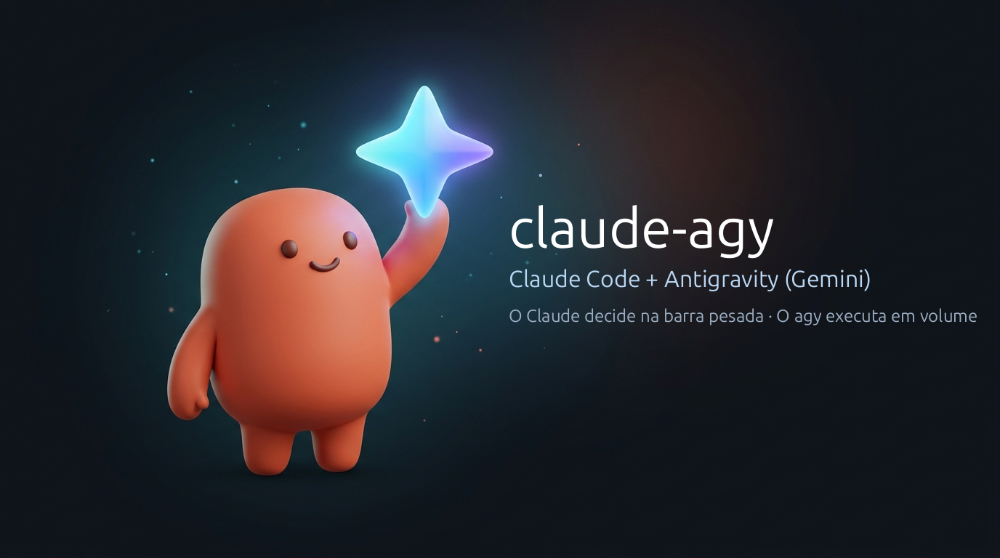

<p align="center">
  
</p>

# claude-agy

<p align="center">
  <b>Português</b> · <a href="README.en.md">Read in English</a>
</p>

<p align="center">
  <a href="https://github.com/Davicjc/claude-agy/actions/workflows/testes.yml"></a>
</p>

Plugin do **Claude Code** que faz o Claude e o **agy** (Antigravity CLI, com modelos Gemini) trabalharem juntos como uma equipe de engenharia:
o Claude assume o papel de **Tech Lead e Arquiteto** (cuida da "barra pesada", raciocínio estratégico, regras de negócio e validação rigorosa), enquanto o agy atua como o **Braço Executor de Alto Volume** (trabalho braçal repetitivo, multimídia e revisão independente) — **economizando tokens preciosos e mantendo o contexto do Claude sempre limpo**.

---

## Por que essa dupla? (Divisão de papéis)

Em projetos reais, queimar a janela de contexto e a cota do Claude com tarefas mecânicas ou arquivos gigantescos é caro e ineficiente. O plugin une o melhor de dois mundos:

| Papel | Quem faz | O que assume |
|---|---|---|
| **A "Barra Pesada"**<br>*(Tech Lead & Arquiteto)* | **Claude Code** | • Planeja a arquitetura e divide problemas complexos em partes isoladas<br>• Define limites de segurança estritos e contratos claros de execução<br>• **Não acredita no "feito"**: audita diffs reais no git, roda testes, confere telas<br>• Toma as decisões difíceis de arquitetura e aprovação final |
| **O Braço Executor**<br>*(Volume & Multimodal)* | **agy (Gemini)** | • Trabalho braçal: refatorações repetitivas em dezenas de arquivos, boilerplate e migrações mecânicas<br>• Multimodal nativo: gerar/editar banners, mockups, ícones, transcrição de áudios de WhatsApp e análise de vídeos .mp4<br>• Revisão cruzada independente: outro modelo, outro cérebro, sem o viés de quem escreveu o código |

---

## Economia real de tokens e contexto

- **Sua cota nobre do Claude fica preservada**: Pesquisas longas em documentações, varreduras massivas de arquivos e geração repetitiva rodam no Gemini via agy. A cota do Claude só é gasta onde o raciocínio profundo é indispensável.
- **Contexto despoluído**: O Claude não engole centenas de linhas de logs, build ou código intermediário. A saída é resumida em até 150 linhas com o relatório limpo do Git. O texto completo fica guardado em disco (`resposta.md`), lido só se necessário.
- **Raciocínio afiado do início ao fim**: Sessões longas continuam rápidas e baratas porque o histórico da conversa não incha com tarefas operacionais.

---

## O que ele faz

| Recurso | Como |
|---|---|
| **Delegar tarefas sem gastar cota** | `agy-tarefa` roda a execução pesada no agy em segundo plano, com pastas liberadas, tempo limite e regras de segurança fixas no prompt |
| **Não acreditar no "feito"** | Compara o git antes e depois (com o hash do conteúdo de cada arquivo) e mostra **o que mudou de verdade**. Avisa se o agy fizer commit, estourar o tempo ou responder vazio |
| **Economia de contexto e tokens** | O Claude recebe só o essencial da resposta (até 150 linhas) e o diff limpo. Textos longos e logs ficam em arquivo para ler só se precisar |
| **Modelo sempre atual** | `agy-modelo` lê `agy models` na hora e escolhe a versão mais nova para cada papel (código, revisão, imagem, pesquisa, rápido). Saiu um Gemini novo? É usado sem editar nada |
| **Revisão cruzada independente** | `agy-revisar` manda um `git diff` para o agy revisar **só lendo** e recebe veredito e achados num formato fixo: gravidade, confiança, arquivo:linha, evidência e sugestão |
| **Trabalho em paralelo** | A skill ensina o Claude a dividir o trabalho em partes sem arquivos em comum (um `git worktree` por parte), rodar várias ao mesmo tempo e validar cada uma antes de juntar |
| **Imagem, áudio e vídeo** | Banner, mockup, ícone, transcrição de áudio de WhatsApp, análise de .mp4, direto do arquivo |
| **Modo economia** | Com a cota do Claude alta (semana ≥ 70% ou janela de 5 h ≥ 80%), o Claude vira só o comandante: decide, escreve uma diretriz quase impossível de errar e o agy executa quase tudo. `agy-cota` diz quando entrar nesse modo |
| **Prestação de contas** | `agy-historico` lista as execuções com status, modelo, tempo e tokens consumidos no agy. Cada uma guarda prompt, resposta e alterações em `~/.cache/agy-skill/execucoes/` |

O Claude usa a skill sozinho quando a tarefa pede. Você também pode chamar direto:

| Comando | O que faz |
|---|---|
| `/agy:delegar <tarefa>` | Delega ao agy e valida o resultado antes de dar como pronto |
| `/agy:revisar [--base main]` | Revisão cruzada das mudanças atuais; o Claude confere cada achado e diz quais são reais |
| `/agy:modelos` | Modelos disponíveis no agy e qual é usado em cada papel |
| `/agy:historico [N]` | Últimas execuções e tokens gastos |
| `/agy:cota` | Uso da cota do Claude e se o modo economia está ligado |

Ou em texto livre: *"pede pro agy refatorar esses 30 arquivos pro padrão novo"*, *"pede pro agy gerar o banner do README com as cores da marca"*, *"transcreve esse áudio do WhatsApp em ~/Downloads"*, *"faz uma revisão cruzada do que mudou desde a main"*.

---

## Testado de verdade

**Com o agy real:**

| Teste | Resultado |
|---|---|
| Corrigir um bug e criar teste | Feito em 27 s; o relatório do git confirmou os arquivos alterados e criados |
| Revisão com 3 problemas plantados (injeção de SQL, senha no código, divisão por zero), um deles em arquivo novo não rastreado | Os **3 encontrados**, cada um com cenário de falha e sugestão |
| Continuar a mesma conversa (`--continuar`) | O agy lembrou o que foi dito na chamada anterior |
| Pedir de propósito um commit ao agy | Detectado (código 3), com o commit e os arquivos listados |
| O ícone deste plugin | Gerado pelo próprio agy (`--papel imagem`) e conferido antes de usar |
| **A skill revisando a si mesma** (4 rodadas) | 11 achados reais nos próprios scripts, cada um conferido antes e todos corrigidos. Uma sugestão foi **recusada**: desligar o `safe.directory` como root abriria uma brecha de segurança |

**Automáticos** ([`tests/rodar.sh`](tests/rodar.sh), com um agy falso, sem rede e sem custo): 114 verificações a cada push. São 98 como usuário comum, no **Linux** e no **macOS com o bash 3.2 de fábrica**, e mais 16 que só fazem sentido **como root**, no Linux. Elas cobrem escolha de modelo (inclusive modelos que ainda não existem), opções erradas, commit indevido, tempo esgotado, resposta vazia, arquivo já modificado editado de novo, pedido de 150 KB, saída longa cortada, tarefas em paralelo, dono dos arquivos (com proteção contra hardlink), recusa do git por dono diferente, revisão a partir de subpasta, diffs grandes, repositório sem commits e a leitura da cota do Claude (modo economia).

---

## Instalação

### Requisitos

- [Claude Code](https://claude.com/claude-code)
- **agy** (Antigravity CLI) instalado e logado: `agy models` precisa listar os modelos
- `bash`, `git` e `python3`

| Sistema | Situação |
|---|---|
| Linux | Testado com o agy real e nos testes automáticos |
| macOS | Testes automáticos com o bash 3.2 de fábrica. Opcional: `brew install coreutils` para ter também o limite de tempo externo |
| Windows | Pelo WSL (é Linux); no Git Bash não foi testado |

### No Claude Code

Em um passo (Claude Code 2.1.275 ou mais novo):

```
/plugin install agy --marketplace Davicjc/claude-agy
```

Ou em dois passos (qualquer versão):

```
/plugin marketplace add Davicjc/claude-agy
/plugin install agy@davicjc
```

Depois rode `/reload-plugins` (ou abra uma sessão nova) e teste com `/agy:modelos`.

### Modo economia (opcional, recomendado)

O Claude Code só entrega o uso da cota (janela de 5 h e semana) para a **status line**. Para o `agy-cota` enxergar esses números, ponha isto em `~/.claude/settings.json`:

```json
{
  "statusLine": {
    "type": "command",
    "command": "sh -c 'd=$(ls -d ~/.claude/plugins/cache/davicjc/agy/*/ | sort -V | tail -1); exec python3 \"$d/skills/agy/scripts/agy-cota\" --statusline'"
  }
}
```

A barra passa a mostrar algo como `Opus · 5h 34% · semana 74% · modo agy`. Os limites mudam com `AGY_COTA_SEMANA` (padrão 70) e `AGY_COTA_SESSAO` (padrão 80). O uso da cota só aparece para assinantes Pro, Max e Ultra do claude.ai. Se você já tem uma status line, chame `agy-cota --statusline` com o mesmo JSON de entrada dentro dela.

### Atualizar

```
/plugin marketplace update davicjc
```

---

## Os scripts (também funcionam sozinhos)

Ficam em `plugins/agy/skills/agy/scripts/`.

```bash
# Qual modelo usar (lido do agy agora)
agy-modelo --listar --atualizar
agy-modelo codigo                      # -> ex.: gemini-4-argon-high

# Tarefa que edita arquivos
agy-tarefa --dir ~/projeto --papel codigo --nome "tela de login" \
           --prompt-arquivo pedido.md --timeout 2400

# Só ler/analisar (sem editar)
agy-tarefa --dir ~/projeto --modo plan --papel pesquisa --prompt "Explique como o cache funciona"

# Continuar a mesma conversa (id em meta.json)
agy-tarefa --dir ~/projeto --continuar <id> --prompt "Agora ajuste o botão"

# Revisão cruzada
agy-revisar --dir ~/projeto                      # tudo desde o HEAD, com arquivos novos
agy-revisar --dir ~/projeto --base main          # desde a main
agy-revisar --dir ~/projeto --intervalo HEAD~3..HEAD --foco "concorrência"
agy-revisar --dir ~/projeto --exigir-aprovado    # código 4 se não for aprovado (automação)

# Histórico e tokens
agy-historico 20

# Cota do Claude: hora do modo economia?
agy-cota                               # MODO=economia|normal|desconhecido, SEMANA=, SESSAO=, MOTIVO=
```

**Papéis:** `codigo`, `revisao`, `pesquisa`, `imagem`, `rapido`. **Forçar um modelo:** `AGY_MODELO_CODIGO=<id>` (por papel) ou `AGY_MODELO=<id>` (todos).

| Código de saída | `agy-tarefa` | `agy-revisar` |
|---|---|---|
| `0` | ok | revisão feita |
| `1` | erro do agy ou resposta vazia | o agy falhou |
| `2` | uso errado | uso errado |
| `3` | ok, mas o agy fez commit | — |
| `4` | — | veredito não aprovado (com `--exigir-aprovado`) |
| `124` | tempo esgotado | — |

---

## Regras de segurança embutidas

- O agy só enxerga e edita as pastas passadas em `--dir` (sem `--dir`, o script recusa).
- Todo pedido leva regras fixas: não commitar, não dar push, não apagar trabalho, não usar `sudo`, não sair das pastas, parar e explicar quando algo impedir a tarefa.
- Nunca usa `--dangerously-skip-permissions`. A revisão roda em modo `plan` (só leitura).
- Na revisão, o diff vai delimitado e com o aviso de que texto dentro do código é dado, não instrução: um comentário malicioso não "manda" o revisor aprovar.
- Rodando como root numa pasta de outro usuário, o que o agy criar pelo terminal (que nasce como root) volta para o dono da pasta.
- A skill orienta o Claude a **conferir tudo** (diff, testes, tela) antes de dizer que está pronto, e a não aplicar achados de revisão sem confirmar cada um.

Problemas comuns e soluções: [`references/problemas.md`](plugins/agy/skills/agy/references/problemas.md).

---

## Estrutura

```
.claude-plugin/marketplace.json          marketplace "davicjc"
plugins/agy/
  .claude-plugin/plugin.json, icon.png
  commands/                              /agy:delegar, /agy:revisar, /agy:modelos, /agy:historico, /agy:cota
  skills/agy/
    SKILL.md                             quando e como delegar, validar, paralelizar e economizar
    scripts/agy-modelo                   escolha dinâmica de modelo
    scripts/agy-tarefa                   execução rastreável
    scripts/agy-revisar                  revisão cruzada estruturada
    scripts/agy-historico                histórico e tokens
    scripts/agy-cota                     uso da cota do Claude e modo economia
    assets/schema-revisao.json           formato dos achados
    references/                          modelo de pedido e solução de problemas
tests/rodar.sh, tests/falso/agy          testes com um agy falso
.github/workflows/testes.yml             testes no Linux e no macOS a cada push
```

Histórico de versões: [`CHANGELOG.md`](CHANGELOG.md).

---

## Licença

MIT, com crédito de autoria obrigatório (veja [LICENSE](LICENSE)). Feito por [Davi Castro](https://davicjc.com).
